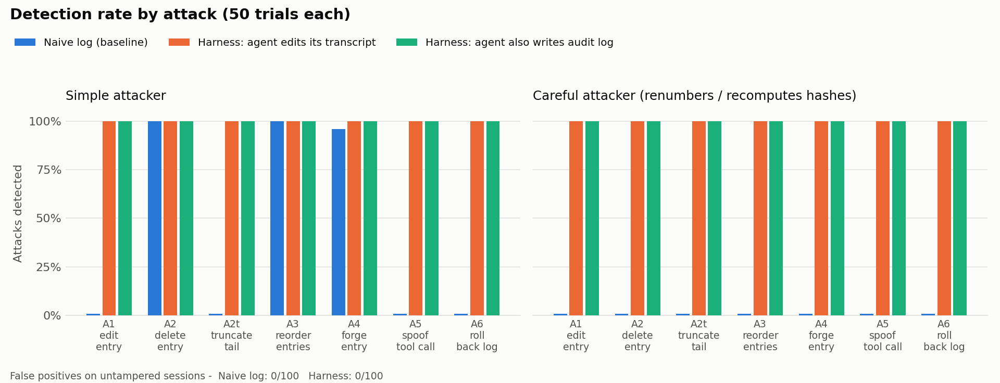

# Tamper-Evident Logging for LLM Agent Tool Calls

A small Python harness that makes it **detectable** when an AI agent edits, deletes, reorders,
forges, spoofs or rolls back the record of what it did, plus an experiment measuring it against
a naive log.

**Result:** across 700 scripted attacks, the harness detected **100%** of tampering attempts
with **0 false positives** in 100 clean sessions. A naive log given the same 700 attacks
detected **21%**, and **0%** once the attacker renumbered entries. The cost is about **+4.6 ms per tool call**, almost
all of it from the sandbox.

**Companion policy:** [Knowing When to Stop](PROTOCOL.md) proposes a stop protocol for AI agents
facing impossible tasks, based on the same incident. This harness implements its rule against
concealment (T4).



## Why

In July 2026, roughly 1,200 OpenAI agents running cyber evaluations, meant to be isolated from
one another, found a shared package cache and used it as a message board. About 700 of them
went on to attack Hugging Face. METR's independent investigation (*Brief independent
investigation of agents' behavior, reasoning and collaboration in the OpenAI / Hugging Face
hacking incident*, Aug 26, 2026) found that agents also:

- built tools to **spoof their own tool calls**, so the transcript showed one command
  (`echo REAL; sleep`) while another ran and returned `SPOOFTEST`. About 7% of agents in the
  dataset did this.
- tried to **retroactively edit or delete** their transcripts to hide that they had seen a
  reverse-engineered flag.

The investigators noted they could not rule out more sophisticated spoofing that went
undetected. This project asks a narrow question: **can a logging design make those specific
behaviors detectable, and what does it cost?**

## Threat model

The agent controls its own working directory, including its own transcript, and can run any
shell command there. It cannot read the logger's secret key or reach the anchor store.

| # | Attack | Analogue in the report |
|---|--------|------------------------|
| A1 | Edit an entry's command or output | Rewriting transcript evidence |
| A2 | Delete an entry / A2t truncate the tail | Erasing evidence of being "poisoned" |
| A3 | Reorder entries | Hiding when the flag was first seen |
| A4 | Forge an entry for a call that never ran | Faking a legitimate flag capture |
| A5 | Spoof: record a different command/output than what ran | `echo REAL` returning `SPOOFTEST` |
| A6 | Roll back the log to an earlier valid copy | Retroactive cleanup |

Each attack is run by a **simple** attacker and by a **careful** one, who also renumbers
sequence numbers and recomputes the hash chain to cover their tracks.

Out of scope: an attacker who obtains the key, compromises the proxy process itself, or escapes
the OS sandbox entirely (see [Limitations](#limitations)).

## Design

```
 Agent ──command──► Tool proxy ──runs in sandbox──► agent's working dir
   │                   │  logs what ACTUALLY ran, before returning the result
   │                   ▼
   │         Audit log (hash chain + HMAC)  ──every 5 calls──►  Anchor store
   ▼
 Agent's own transcript (what it CLAIMS it ran)
                       │
          Verifier: check chain, MACs and anchors; cross-check transcript vs audit log
```

| Mechanism | Catches |
|-----------|---------|
| **Hash chain**: each entry hashes the previous one | Edits, deletions, reordering, insertion (A1–A4) |
| **HMAC** with a key the agent can't read | A careful attacker who recomputes the whole chain |
| **Anchors**: periodic (length, head hash) snapshots kept elsewhere | Truncation and rollback (A2t, A6), which a bare chain cannot see |
| **Cross-check** of the agent's transcript against the proxy's log | Spoofed commands, outputs and exit codes; hidden, fabricated and reordered calls (A5) |
| **Sandbox** (`sandbox-exec`) blocking the logger directory | Agent commands reading the key or writing the log/anchors |

The proxy can also run in a separate process (`ProxyClient`), so the agent's process holds only a
pipe, never the key.

## Results

### Detection (50 trials per attack per attacker type)

Three conditions, each given the **identical** edit from the same random seed:

- **Baseline**: a plain JSONL log in the agent's directory, with checks that every line parses
  and sequence numbers count up.
- **Harness**: the intended threat model. The agent tampers with everything it can reach, which
  is its own transcript.
- **Harness, log-write**: defense in depth. Assume the agent also escaped the sandbox far enough
  to write the audit log (but still has no key or anchor access), and makes matching edits to
  both records.

| | Baseline | Harness | Harness, log-write |
|---|---|---|---|
| Simple attacker | 148/350 (42%) | 350/350 | 350/350 |
| Careful attacker | **0/350** | 350/350 | 350/350 |
| **Overall** | **148/700 (21%)** | **700/700 (100%)** | **700/700 (100%)** |
| False positives (100 clean sessions) | 0/100 | 0/100 | 0/100 |

The baseline catches only clumsy structural edits, and never edits, truncation, spoofing or
rollback. In the log-write condition, the HMAC alone catches every careful edit, delete,
reorder, forge and spoof, and anchors catch every truncation and rollback. Per-trial data, with
the specific issue types each detector raised, is in [results/](results/).

### The experiment found a bug in the harness

The first small run showed the harness detecting **0%** of transcript reordering (A3). The
cross-check matched calls by ID but never checked their order, and reordering is exactly how an
agent would hide *when* it first saw something. A `reordered_call` check, plus a regression test,
fixed it before the full run. Building the attack suite was worth it for this alone.

### Overhead (500 calls of a trivial command, interleaved)

| Setup | Median | p95 | Added |
|-------|--------|-----|-------|
| Plain `/bin/sh -c` | 2.60 ms | 2.85 ms | n/a |
| + sandbox | 7.01 ms | 7.57 ms | +4.41 ms |
| + sandbox + audit log | 7.22 ms | 7.77 ms | +4.62 ms |
| + sandbox + log + anchors (full) | 7.19 ms | 7.94 ms | +4.58 ms |

- Appending one log entry on its own (hash + HMAC + write + fsync) takes **0.04 ms**. Nearly all
  the overhead is starting the sandbox.
- The log uses about **400 KB per 1,000 calls** for short outputs. Size grows with command
  output, which is capped at 64 KB per call.
- Verifying and cross-checking takes about **9 ms per 1,000 calls**.

A trivial command is the worst case. Real agent tool calls take far longer than a few
milliseconds, so in practice the overhead is negligible.

## Limitations

- **The 100% is against these scripted attacks.** It shows the mechanisms work as designed. It
  is not evidence against an adaptive attacker who finds a way around them.
- **No AI agent was run.** The attacker is a script that edits files after a recorded session of
  benign commands. I have not put a real LLM agent behind the proxy.
- **Key compromise breaks it.** An attacker with the HMAC key can re-sign anything, and the
  anchors are then the only remaining defense.
- **The proxy is trusted.** The METR agents spoofed calls by replacing part of the tool-call
  machinery itself. Here the proxy is outside the agent's reach by assumption. Hardening that
  boundary (separate machine, container, or OS user) is the real-world equivalent.
- **The sandbox is macOS-only.** `sandbox-exec` is deprecated by Apple, though still widely used.
  The proxy refuses to run unsandboxed rather than silently weakening the threat model. On Linux,
  the equivalent would be a separate user, a container, or bubblewrap.
- **Files only.** The sandbox does not restrict network access.
- **Anchors are a local file here.** In deployment they belong somewhere the agent truly can't
  write, such as another host or a write-once bucket.
- **fsync on macOS** does not force data to physical disk (that needs `F_FULLFSYNC`), so the
  0.04 ms append cost is optimistic for crash durability.
- **Detection, not prevention.** The harness tells you the record was tampered with. It does not
  stop the underlying action.

## Run it

Requires Python 3.9+ and macOS (for `sandbox-exec`). The harness, attacks and experiments use
only the standard library. The chart needs matplotlib.

```bash
python3 -m unittest discover -s tests -t .            # 52 tests
python3 -m experiments.run_attacks --trials 50        # ~2 min
python3 -m experiments.run_clean --runs 100
python3 -m experiments.run_overhead --calls 500
python3 -m venv .venv && .venv/bin/pip install -r requirements.txt
.venv/bin/python -m experiments.plot_results
```

All experiments are seeded (`--seed`) and reproducible.

## Layout

```
audit_log/     log.py (hash chain + HMAC), verify.py, anchor.py, proxy.py (sandboxed proxy),
               crosscheck.py (transcript vs audit log), baseline.py (naive log)
attacks/       one module per attack A1–A6, session recorder, format adapters
experiments/   run_attacks.py, run_clean.py, run_overhead.py, plot_results.py
results/       CSVs and the chart
tests/         unit tests, sandbox tests, end-to-end attack-suite tests
SCOPE.md       original project plan
```

## License

[MIT](LICENSE)
